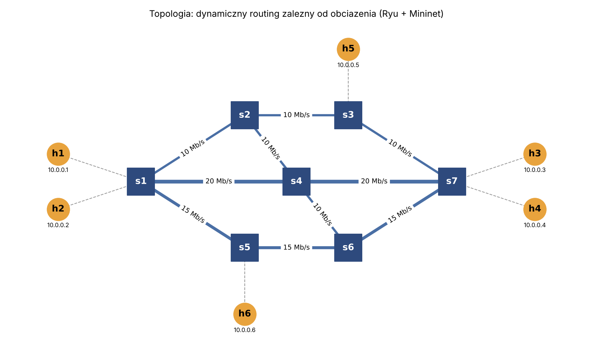

# SSP – Dynamiczny routing zależny od obciążenia łączy

Kontroler SDN (Ryu, OpenFlow 1.3) wybierający ścieżki na podstawie aktualnego obciążenia łączy
oraz topologia testowa w Mininecie.

## Co jest zrobione

- `links.json` – konfiguracja topologii: 7 switchy, 6 hostów, łącza z przepustowościami (10/15/20 Mb/s).
- `topo.py` – topologia Mininet budowana z `links.json` (łącza TCLink z limitem pasma i opóźnieniem 2 ms).
- `draw_topology.py` – rysuje topologię z `links.json` do `docs/topology.png`.
- `controller.py` – aplikacja Ryu:
  - wykrywanie topologii przez LLDP,
  - pomiar obciążenia łączy ze statystyk portów (co 2 s),
  - wagi łączy zależne od wolnego pasma i Dijkstra dla nowych przepływów,
  - przełączanie przepływu na inną ścieżkę, gdy łącze przekracza 80% zajętości,
  - proxy ARP,
  - tryb statyczny (najkrótsza ścieżka po liczbie skoków) do porównania.

## Topologia



Sieć składa się z 7 switchy OpenFlow (kwadraty `s1`–`s7`) i 6 hostów (kółka `h1`–`h6`, adresy `10.0.0.1`–`10.0.0.6`).
Między `s1` a `s7` są trzy rozłączne ścieżki o różnej przepustowości:

- górna `s1-s2-s3-s7` – 10 Mb/s,
- środkowa `s1-s4-s7` – 20 Mb/s (najkrótsza, domyślnie wybierana przy pustej sieci),
- dolna `s1-s5-s6-s7` – 15 Mb/s,

oraz łącza poprzeczne `s2-s4` i `s4-s6` (10 Mb/s). Grubość linii na rysunku odpowiada przepustowości łącza.
Hosty `h1`, `h2` (przy `s1`) i `h3`, `h4` (przy `s7`) generują główny ruch, a `h5` (przy `s3`) i `h6` (przy `s5`)
służą do dociążania górnej i dolnej ścieżki. Łącza host–switch (linie przerywane) mają 100 Mb/s,
żeby wąskim gardłem był rdzeń sieci.

Topologia jest opisana w `links.json`, a `topo.py` tworzy z niej sieć w Mininecie: w klasie `Topo`
dodaje switche (`addSwitch`), hosty (`addHost`) i łącza (`addLink` z parametrami `bw` i `delay`),
a następnie łączy sieć ze zdalnym kontrolerem (`RemoteController`). Rysunek generuje `draw_topology.py`.

## Uruchomienie

```bash
# terminal 1 – kontroler
ryu-manager --observe-links --ofp-tcp-listen-port 6633 controller.py
# tryb statyczny:
ROUTING_MODE=static ryu-manager --observe-links --ofp-tcp-listen-port 6633 controller.py

# terminal 2 – sieć
sudo python3 topo.py

# rysunek topologii
python3 draw_topology.py
```

## Literatura

1. **N. L. M. van Adrichem, C. Doerr, F. A. Kuipers, „OpenNetMon: Network monitoring in OpenFlow Software-Defined Networks”**, IEEE/IFIP NOMS, 2014.
   [PDF](https://www.cyber-threat-intelligence.com/publications/NOMS2014-OpenNetMon.pdf)
   Opisuje moduł kontrolera (POX) do monitorowania sieci OpenFlow: zbieranie statystyk portów i przepływów
   oraz liczenie na ich podstawie przepustowości, opóźnień i strat pakietów dla każdego przepływu.
   Częstotliwość odpytywania switchy jest dobierana adaptacyjnie, żeby nie obciążać kontrolera i sieci.

2. **N. Aqila, „Comparative Analysis of Shortest Path and Load Balancing Algorithms in Software-Defined Networking Using Ryu Controller and Mininet”**, Jurnal JTIK, vol. 10, nr 4, 2026.
   [link](https://www.researchgate.net/publication/416612553_Comparative_Analysis_of_Shortest_Path_and_Load_Balancing_Algorithms_in_Software-Defined_Networking_Using_Ryu_Controller_and_Mininet)
   Praca w tym samym środowisku co nasz projekt (Ryu + Mininet). Porównuje routing najkrótszą ścieżką
   z równoważeniem obciążenia (Round Robin) na tej samej topologii, mierząc przepustowość iperfem.
   Najkrótsza ścieżka korzysta z jednej dominującej trasy (6,46 Gbit/s łącznie), a równoważenie obciążenia
   rozkłada ruch na kilka ścieżek i osiąga 9,65 Gbit/s.

3. **Z. Shu i in., „Traffic Engineering in Software-Defined Networking: Measurement and Management”**, IEEE Access, vol. 4, 2016.
   [link](https://www.researchgate.net/publication/304365495_Traffic_engineering_in_software-defined_networking_Measurement_and_management)
   Przegląd inżynierii ruchu w SDN, która dzieli się na pomiar ruchu i zarządzanie ruchem.
   Część pomiarowa obejmuje pomiar parametrów sieci oraz analizę i predykcję ruchu, a część zarządzająca –
   równoważenie obciążenia, szeregowanie z gwarancją QoS i zarządzanie ruchem w sieciach hybrydowych IP/SDN.

4. **M. Majdoub, A. El Kamel, H. Youssef, „Routing Optimization in SDN using Scalable Load Prediction”**, GIIS, 2019.
   [link](https://www.researchgate.net/publication/340229620_Routing_Optimization_in_SDN_using_Scalable_Load_Prediction)
   Routing w SDN oparty na przewidywaniu przyszłego wolnego pasma siecią neuronową (MLP), liczonym dla całych
   ścieżek zamiast pojedynczych łączy, co poprawia skalowalność w dużych sieciach. Przewidziane wartości trafiają
   do algorytmu Dijkstry jako metryka odwrotna do dostępnego pasma – podobnie jak wagi w naszym kontrolerze.

### Dodatkowe

5. **Open Networking Foundation, „OpenFlow Switch Specification, Version 1.3.0”**, 2012.
   [PDF](https://opennetworking.org/wp-content/uploads/2014/10/openflow-spec-v1.3.0.pdf)
   Oficjalna specyfikacja protokołu OpenFlow 1.3, którego używa nasz kontroler. Opisuje tablice przepływów,
   pola dopasowania i priorytety reguł oraz budowę komunikatów, m.in. Packet-In, Packet-Out i statystyk portów
   (OFPPortStatsRequest/Reply).

6. **Dokumentacja Ryu** – [ryu.readthedocs.io](https://ryu.readthedocs.io/en/latest/)
   Dokumentacja kontrolera Ryu: tworzenie aplikacji, obsługa zdarzeń OpenFlow, API do wykrywania topologii
   (`ryu.topology`) oraz przykładowe aplikacje.
